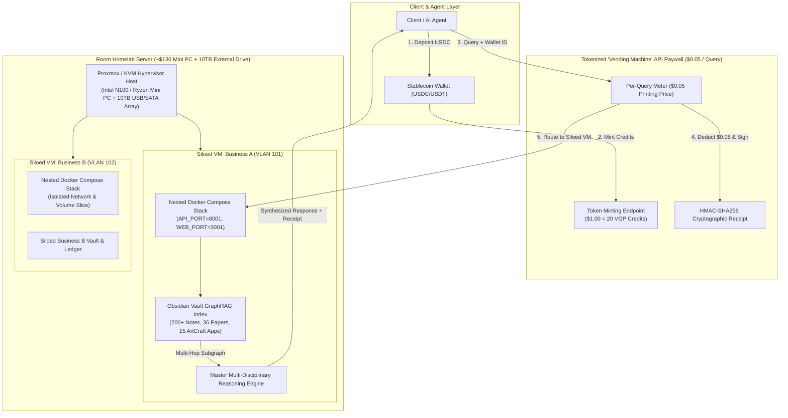

# `vault-graphrag-paywall`

**Cloud & Homelab Obsidian Vault GraphRAG Synthesis Engine with a Stablecoin Tokenized "Vending Machine" API Paywall ($0.05 "Printing Prices") & Per-Business Siloed VM + Docker Architecture.**

---

## Installation

Install globally as an Agent Skill via the Skills CLI:

```bash
npx skills add NoJuanNobody/vault-graphrag-paywall -g
```

Or install the Python package locally:

```bash
pip install -e .
```

---

## Architecture Overview



---

## Key Capabilities

### 1. Obsidian Vault GraphRAG Indexer (`vault_indexer.py`)
- Indexes Markdown files across an Obsidian Vault directory tree or loads the built-in multi-disciplinary seed vault representing **~200+ notes/papers**, **36 research papers**, **15 ArtCraft apps** (`VectorCraft`, `Photocraft`, `LightCraft`, `DesignCraft`, `FilmCraft`, `EffectCraft`, `SoundCraft`, `CadCraft`, `FigCraft`, `DeckCraft`, `GridCraft`, `WordCraft`, `PdfCraft`, `ScriptCraft`, `InkDraw`), **Graphic Engineering loops**, **Architectural Design Thinking**, **3D/PCB Hardware Fabrication**, and **Quantum Orch-OR Consciousness**.
- Extracts YAML frontmatter (`domain`, `papers`, `craft_app`), `#tags`, and `[[wikilinks]]` to construct an entity-relationship adjacency graph (`nodes` and `edges`).

### 2. Stablecoin "Vending Machine" API Paywall (`vending_paywall.py`)
- Implements a pre-funded stablecoin token ledger where `$1.00 USD` mints `20` query tokens at **$0.05 per query ("printing prices")**.
- Generates tamper-evident **HMAC-SHA256 receipts** for every metered query and enforces strict balance checks (`InsufficientBalanceError`).

### 3. Multi-Disciplinary GraphRAG Synthesis Engine (`graphrag_engine.py`)
- Combines multi-hop graph traversal (`max_hops=2`) with the **Master Multi-Disciplinary Reasoning Prompt**:
  > *"Act as an advanced multi-disciplinary reasoning engine specializing in the convergence of creative systems, architectural design thinking, computational frameworks, and physical fabrication pipelines. Analyze the provided domain queries by utilizing the established lexicographical taxonomy, integrating visual resource references, executing incremental GraphRAG synthesis across craft app subdomains, and employing graphic engineering loops and hardware fabrication logic to ensure precise execution for automated synthesis."*

### 4. Homelab Per-Business Siloed VM + Docker Provisioner (`homelab_silo.py`)
- Models a **~$130 Mini PC** (4 vCPU, 16GB RAM) paired with a **10TB external hard drive** (`10,000 GB`).
- Provisions dedicated KVM/Proxmox Virtual Machines (`VMSiloSpec`) per business tenant with isolated VLAN tags, dedicated storage slices on the 10TB drive, and nested Docker Compose stacks (`API_PORT=8001`, `WEB_PORT=3001`).

---

## CLI Usage

```bash
# Run full end-to-end JSON demo
vault-paywall demo

# Index the seed Obsidian vault and inspect graph metrics
vault-paywall index

# Mint $0.50 USD (10 queries at $0.05/query) for a wallet
vault-paywall vending-mint --wallet studio-alpha --usd 0.50

# Execute a metered GraphRAG query ($0.05 deducted)
vault-paywall query --wallet studio-alpha --query "CadCraft PCB fabrication and Graphic Engineering loops" --hops 2

# Output Homelab VM Silo spec and nested Docker Compose YAML
vault-paywall homelab-spec --business-id studio-alpha --storage-gb 500 --port 8001
```

---

## Testing

```bash
pytest -v
```
